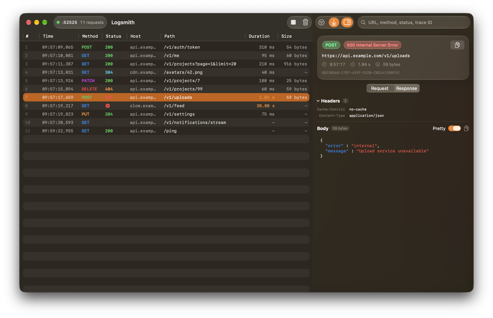

# Logsmith

A small Mac app that shows the network requests your app makes, live. Point your iOS simulator or Mac app at it, and every request shows up with its headers, body, status, and timing.

There's no SDK to add. Your app sends a JSON POST to a local endpoint, and Logsmith shows it.



- Live table of requests, sortable and searchable
- Request and response headers and bodies, with JSON pretty printing and highlighting
- Filter by status, method, and host, or search inside bodies
- Failed requests (timeouts, no connection) shown with their error
- Copy as cURL
- Liquid Glass UI on macOS 27

Everything stays in memory and is gone when you quit.

## Requirements

- macOS 27 or later
- Xcode 27 (Swift 6.4)

## Run

Logsmith is a Swift package. Clone it and run:

```bash
./run.sh
```

This builds the app, wraps it in `Logsmith.app`, and opens it. It listens on `http://127.0.0.1:52525/log`. You can change the port in Settings (⌘,).

To see it with demo data, run this while Logsmith is open:

```bash
scripts/seed.sh
```

## Send requests from your app

POST JSON to `http://127.0.0.1:52525/log`. Send one object or an array of objects.

| Field | Type | Notes |
|---|---|---|
| `traceId` | string | Ties a request and its response together. Defaults to a new UUID. |
| `timestamp` | number | Unix time in seconds. Defaults to now. |
| `phase` | string | `request` or `response`. Defaults to `request`. |
| `method` | string | Defaults to `GET`. |
| `url` | string | Full URL. |
| `requestHeaders` | object | String to string. |
| `requestBody` | string | |
| `statusCode` | number | |
| `responseHeaders` | object | String to string. |
| `responseBody` | string | |
| `elapsedMs` | number | Duration in milliseconds. |
| `error` | string | Set when the request failed without a response. |

Every field is optional. Logsmith replies `204` on success and `422` if it can't read the JSON.

You can send everything in one `response` entry when the request finishes. If you also want in-flight requests to show as pending, send a `request` entry first, then a `response` entry with the same `traceId`.

### Swift

Copy this into your app and call it after a request finishes:

```swift
import Foundation

#if DEBUG
enum Logsmith {
    static let endpoint = URL(string: "http://127.0.0.1:52525/log")!

    static func log(_ request: URLRequest, data: Data?, response: URLResponse?, error: Error?, startedAt: Date) {
        let http = response as? HTTPURLResponse
        let entry: [String: Any?] = [
            "traceId": UUID().uuidString,
            "timestamp": startedAt.timeIntervalSince1970,
            "phase": "response",
            "method": request.httpMethod ?? "GET",
            "url": request.url?.absoluteString ?? "",
            "requestHeaders": request.allHTTPHeaderFields ?? [:],
            "requestBody": request.httpBody.map { String(decoding: $0, as: UTF8.self) },
            "statusCode": http?.statusCode,
            "responseHeaders": http?.allHeaderFields as? [String: String],
            "responseBody": data.map { String(decoding: $0, as: UTF8.self) },
            "elapsedMs": Date().timeIntervalSince(startedAt) * 1000,
            "error": error?.localizedDescription,
        ]
        var upload = URLRequest(url: endpoint)
        upload.httpMethod = "POST"
        upload.httpBody = try? JSONSerialization.data(withJSONObject: entry.compactMapValues { $0 })
        URLSession.shared.dataTask(with: upload).resume()
    }
}
#endif
```

```swift
let startedAt = Date()
let (data, response) = try await URLSession.shared.data(for: request)
#if DEBUG
Logsmith.log(request, data: data, response: response, error: nil, startedAt: startedAt)
#endif
```

Use a separate `URLSession` for the upload if your app logs every request on `URLSession.shared`, so Logsmith's own traffic doesn't get logged.

### curl

```bash
curl -X POST http://127.0.0.1:52525/log \
  -H 'Content-Type: application/json' \
  -d '{"method":"GET","url":"https://api.example.com/users","phase":"response","statusCode":200,"elapsedMs":84,"responseBody":"{\"users\":[]}"}'
```

## Notes

- Logsmith listens on `127.0.0.1` only. The iOS simulator can reach it, a physical device can't.
- Start Logsmith before your app so nothing is missed.

## Shortcuts

| Shortcut | Action |
|---|---|
| ⌘K | Clear requests |
| ⌘R | Start or stop the server |
| ⌥⌘0 | Reset filters |

## Development

```bash
swift build
swift test
```

## License

MIT. See [LICENSE](LICENSE).
